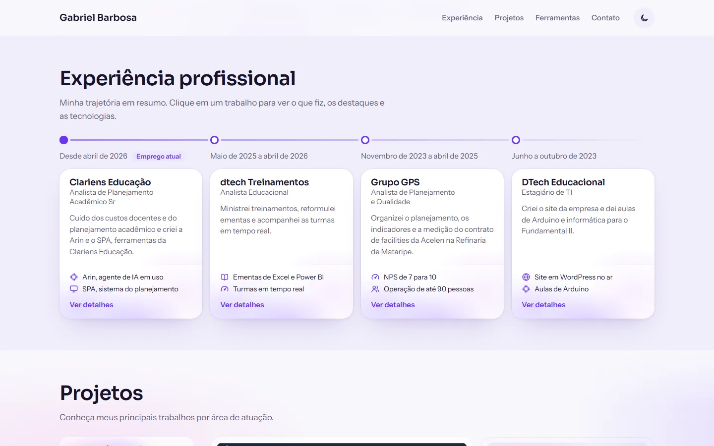
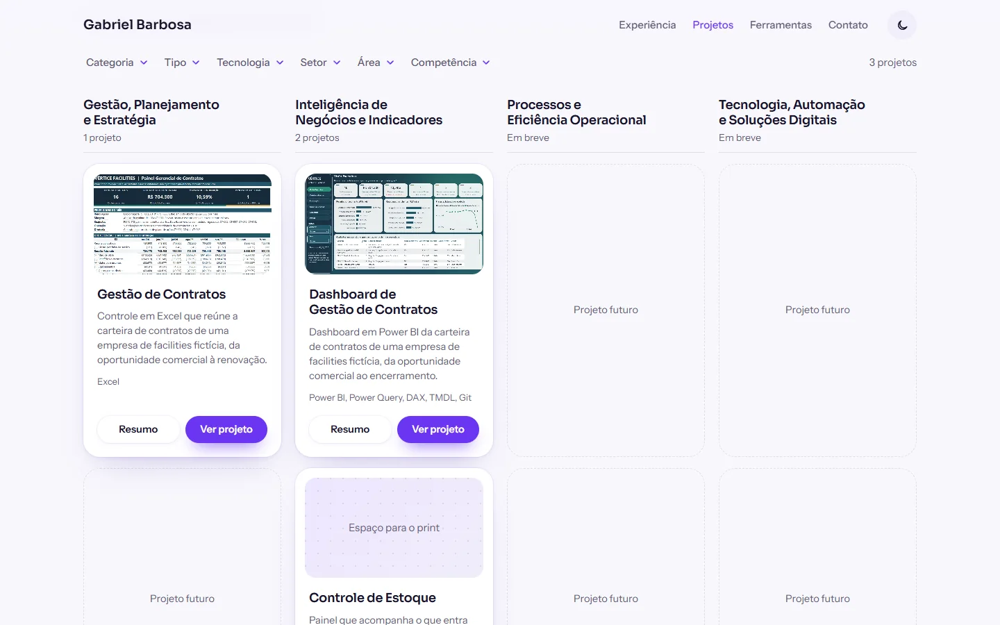
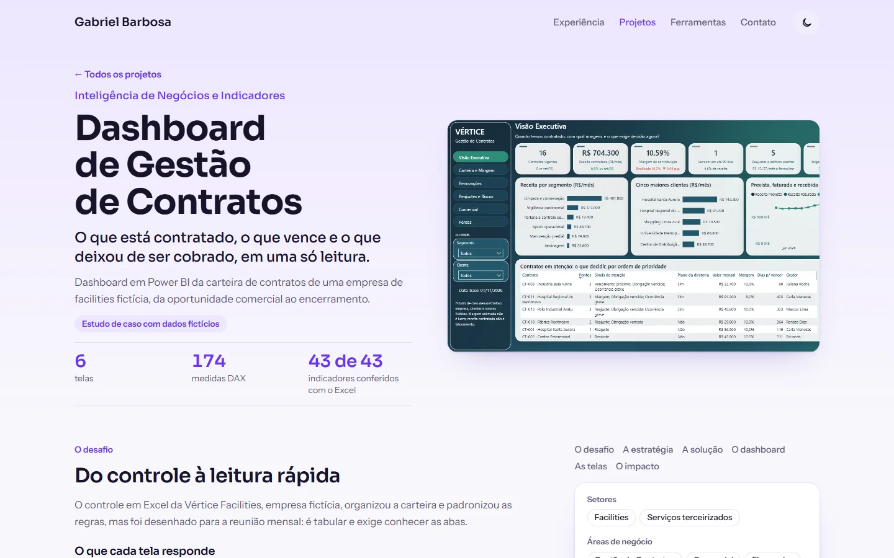

# Portfólio | Gabriel Barbosa

Dados, planejamento e gestão para transformar metas em resultados.


## Finalidade

Este site reúne, em um só lugar, a trajetória profissional, a formação e os projetos de Gabriel Barbosa. Ele foi feito para que recrutadores e gestores entendam rapidamente como dados e planejamento se conectam para alinhar áreas, acompanhar metas e apoiar boas decisões.

## O que você encontra

- **Trajetória:** linha do tempo com os trabalhos, os destaques de cada um e as tecnologias usadas.
- **Formação:** cursos e certificações, com detalhes em popups.
- **Projetos:** vitrine na página inicial e uma página com todos os projetos por categoria, com filtros.
- **Estudos de caso:** cada projeto completo mostra o desafio, a estratégia, a solução, as telas e o impacto.
- **Ferramentas e habilidades:** o conjunto de recursos usados no dia a dia.
- **Contato:** e-mail, LinkedIn e GitHub, sempre à mão.

## Telas

### Experiência profissional



### Projetos por categoria



### Estudo de caso



### Modo escuro


## Projetos em destaque

Os dois estudos de caso abaixo usam a Vértice Facilities, uma empresa fictícia. Os dados são simulados e não representam resultados de uma empresa real.

- [Gestão de Contratos](https://github.com/Gabriiel-Barbosa/contratos_vertice_facilities): controle em Excel da carteira de contratos, da oportunidade comercial à renovação.
- [Dashboard de Gestão de Contratos](https://github.com/Gabriiel-Barbosa/contratos_vertice_facilities_Dashboard): dashboard em Power BI da mesma carteira, com leitura visual para decisão.

Novos projetos entram aos poucos.

## Como o site foi construído

- HTML, CSS e JavaScript puros, sem framework e sem etapa de build.
- Modo claro e escuro, com a preferência salva no navegador.
- Layout responsivo, com respeito à configuração de reduzir movimento do sistema.
- Filtros com o estado no endereço, para que um link já abra a lista filtrada.
- Conteúdo separado do comportamento: para incluir um projeto, basta acrescentar um item em `docs/assets/js/dados/projetos.js`.
- Publicação estática no GitHub Pages, a partir da pasta `docs/`.

## Estrutura

```
docs/
  index.html              Página inicial
  projetos.html           Lista de projetos com filtros
  projeto.html            Página completa de um projeto
  assets/
    css/estilo.css        Estilos e temas
    img/                  Imagens, ícones e prints
    js/
      base.js             Tema, rodapé e popup de contato
      app.js              Popups de experiência e formação
      vitrine.js          Vitrine de projetos da página inicial
      projeto-comum.js    Card e popup de resumo de projeto
      projetos.js         Filtros e organização por categoria
      projeto.js          Montagem da página de cada projeto
      dados/              Empregos, formações e projetos
```

## Como ver localmente

Baixe o repositório e abra `docs/index.html` no navegador. Não é preciso instalar nada.

## Contato

- [LinkedIn](https://www.linkedin.com/in/gabriel-barbosa-j/)
- [GitHub](https://github.com/Gabriiel-Barbosa)
- E-mail: gabriel.barbosa.j01@gmail.com

© 2026 Gabriel Barbosa. Todos os direitos reservados.
